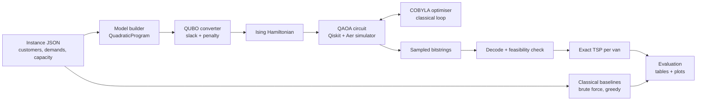

# 01 — PROJECT SPEC: Quantum Last-Mile Delivery Assignment

## One-line pitch
A small delivery company has one depot, two vans with limited capacity and six customers. We use QAOA (a hybrid quantum-classical algorithm) to decide which van serves which customer so routes are short and loads fair, and we check the answer against exact classical search.

## 1. Identify (Rubric A)
- **Domain:** Logistics & Transportation → delivery assignment / distribution planning.
- **Users:** dispatchers at small courier, pharmacy or grocery delivery businesses.
- **Why it matters:** assigning stops to vehicles is the hard core of vehicle routing (VRP), which is NP-hard; fuel, time and driver fairness depend on it.
- **Competing objectives:** (1) short total distance, (2) balanced workload between drivers. **Limited resource:** van capacity Q.
- **Originality angle:** hybrid "cluster-first, route-second" design: quantum solves the combinatorial assignment, classical solves exact routing inside each van. Plus a Pareto sweep of the distance-vs-fairness trade-off.

## 2. Formulate (Rubric A)
Instance: depot at (0,0); n=6 customers (coordinates, demands in `config/instance.json`); K=2 identical vans, capacity Q=7; total demand 12.

- **Decision variables:** y_i ∈ {0,1}; y_i=0 → van A serves customer i, y_i=1 → van B.
  (One qubit per customer; "each customer served exactly once" is automatically satisfied by this encoding.)
- **Loads:** L_B = Σ d_i y_i, L_A = D − L_B (D = total demand).
- **Objective (minimise):**
  `f(y) = α · Σ_{i<j} D_ij · [y_i = y_j]  +  β · (L_B − L_A)²`
  first term = compactness proxy (customers sharing a van should be close), second = load imbalance. Both are quadratic → QUBO-friendly. Expand [y_i=y_j] = y_i y_j + (1−y_i)(1−y_j).
- **Constraints (capacity):** L_A ≤ Q and L_B ≤ Q ⇔ `D − Q ≤ L_B ≤ Q` ⇔ 5 ≤ L_B ≤ 7. Two linear inequalities.
- **QUBO conversion:** `QuadraticProgramToQubo` adds slack variables for inequalities and a penalty term → about 12 qubits total (6 decision + ~6 slack).
- **True metric for evaluation:** after assignment, compute each van's exact shortest tour (brute-force TSP, ≤6 stops) → total route length. The QUBO objective is a proxy; true length is what dispatchers care about.
- **Optional symmetry break:** vans are identical so every solution has a mirror (y ↔ 1−y). Fix y_1=0 to save one qubit (optional).

## 3. Justify the algorithm (Rubric B)
- QUBO ↔ Ising Hamiltonian is a natural fit for **QAOA** (Quantum Approximate Optimisation Algorithm): alternate cost layer e^{-iγH_C} and mixer layer e^{-iβH_M}, p repetitions, classical optimiser (COBYLA) tunes 2p angles.
- Why not Grover? Needs oracle design and exact threshold; QAOA is designed for combinatorial optimisation.
- Why not VQE? Also valid, but QAOA's ansatz is problem-informed (shallower, interpretable).
- Assumptions/limits to state: simulator only; p small; penalty tuning matters; barren plateaus / local minima; no proven speedup at this size; slack qubits inflate the circuit; ~12 qubits is classically trivial (brute force = 64 options).

## 4. Implement (Rubric C)
Stack: Python 3.11, `qiskit`, `qiskit-aer`, `qiskit-algorithms` (QAOA), `qiskit-optimization` (QuadraticProgram, QUBO converter, MinimumEigenOptimizer), numpy, scipy, matplotlib, pandas, pytest.

## 5. Evaluate
Baselines: (a) exact brute force over all 64 assignments + exact TSP, (b) greedy/sweep heuristic, (c) optional simulated annealing, (d) NumPyMinimumEigensolver on the same QUBO (sanity check of the encoding).
Report: qubits, circuit depth, p, seeds, P(optimum), P(feasible), best feasible found, gap % vs exact, runtime. Sweep β for a Pareto curve.
Expected honest findings: QAOA at p=1 finds the optimum with modest probability; improves with p; some sampled states infeasible; classical brute force is faster at this size.

## 6. Reflect
Correctness (QUBO ground state = classical optimum), feasibility (simulator ok; hardware noise/depth would hurt), scaling (n customers × K vans → qubits grow, slack bits), trade-offs (penalty weight vs landscape), what a next step would be (larger n, K>2 with one-hot, real road distances, time windows, hardware runs).

## Architecture (for the diagram — Mermaid)

