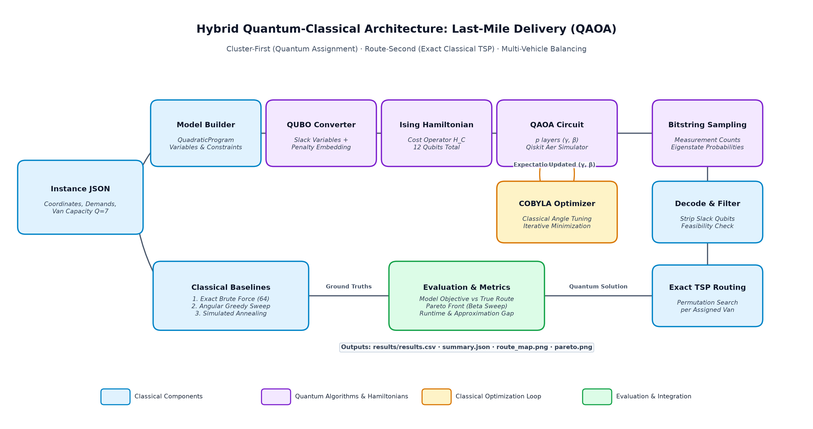

# Quantum Last-Mile Delivery Assignment

> **Qiskit Fall Fest 2026 — Logistics & Transportation**

We assign six delivery customers to two capacity-limited vans.
QAOA searches a QUBO assignment; exact classical routing evaluates each van.
We compare the quantum samples with brute force, greedy, and simulated annealing baselines.

## Problem and motivation

Small courier teams need routes that are short without overloading one driver. Vehicle
routing is combinatorial, so even a small dispatch decision is a useful optimization
case study. Our instance has one depot, six customers, two identical vans, total demand
12, and capacity 7 per van.

## Formulation

Each customer has one binary variable `y_i`: `0` assigns van A and `1` assigns van B.
The model minimizes

```text
alpha * sum(distance(i,j) for customers sharing a van)
  + beta * (load_B - load_A)^2
```

with both van loads at most 7. The QUBO conversion adds slack variables for the
capacity inequalities. The six assignment variables plus slack use about 12 qubits.
The QUBO is a compactness proxy; after assignment, exact brute-force TSP routes give
the true route length.

## Why QAOA?

QAOA directly maps a binary quadratic objective to an Ising Hamiltonian and alternates
problem cost and mixer layers. Our hybrid **cluster-first / route-second** design uses
QAOA for the assignment and classical exact TSP for each van. This keeps the quantum
part small, interpretable, and easy to check against exhaustive search.

## Architecture



The source diagram is maintained separately in `docs/architecture.*`; the pipeline is
instance JSON → QUBO → QAOA samples → feasibility decoding → exact routes → reports.

## Repository layout

| Path | Purpose |
|---|---|
| `src/contract.py` | Frozen instance and objective contract |
| `src/classical.py` | Exact and heuristic baselines |
| `src/qubo_model.py` | Quadratic program and QUBO conversion |
| `src/quantum_solver.py` | QAOA/Aer runs and circuit output |
| `src/evaluate.py` | CSV, summary, and figures |
| `src/run_demo.py` | End-to-end runner |
| `results/` | JSON, CSV, circuit image, and plots |
| `tests/` | Focused contract and pipeline checks |

## Setup and run

```bash
python -m venv .venv
# Windows:
.venv\Scripts\activate
# macOS/Linux:
# source .venv/bin/activate
pip install -r requirements.txt
python -m src.run_demo
```

For a quick check, use `python -m src.run_demo --fast`. The evaluator can also use
the checked-in schema fixtures with `python -m src.evaluate --mock`.

## Expected output

The demo prints the exact route, QAOA route and gap, qubit count, probabilities for
each repetition, and stage timings. The checked-in sample summary reports:

| Quantity | Value |
|---|---:|
| Exact optimum route length | 41.4972 |
| Best QAOA route length | 50.9417 |
| QAOA gap | 22.76% |
| Qubits | 12 |
| Exact-eigen match | true |

The authoritative numbers after a run are in `results/summary.json`.

## Classical comparison

Brute force over 64 assignments is the exact reference. Greedy and simulated annealing
provide inexpensive baselines. QAOA is evaluated by feasible assignment probability,
optimum probability, and route-length gap. At this instance size, classical exhaustive
search is expected to be faster; this project makes no quantum-advantage claim.

## Honest limitations

This is a six-customer simulator experiment, not a production route planner. The QUBO
objective is a proxy for route distance, slack qubits increase circuit size, penalty
weights and optimizer seeds affect QAOA, and noisy hardware may reduce solution
quality. Larger fleets, time windows, road-network distances, and hardware execution
are natural next steps.

## Team and credits

- **Usama** — classical baselines and report
- **Fatima** — QUBO and quantum solver
- **Khattak** — integration, evaluation, demo, and presentation assets

We used Qiskit documentation for API guidance and credit the Qiskit project. AI
assistants used: Antigravity/Codex. Report and video: `[link to be added]`.
